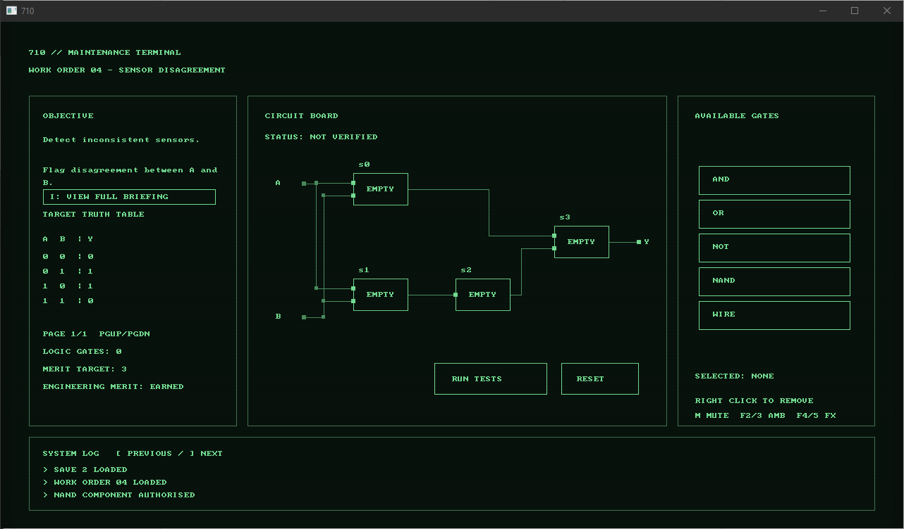

# 710

**COMP3016 — Immersive Game Technologies | Coursework 1**  
**C++20 · SDL3 · 2D Boolean-logic puzzle game**

[**Full coursework report**](report.md) · [**GitHub repository**](https://github.com/MrabDflong/710) · [**Demonstration video — ADD UNLISTED YOUTUBE URL**](https://youtu.be/SONVK6t9HS8)

## About the game

710 is a Boolean-logic puzzle game set aboard an abandoned North Sea oil rig. Playing as an apprentice engineer, you repair an automation terminal by placing logic gates into predefined circuit sockets and constructing circuits that satisfy target truth tables.

The game contains **10 work orders**, increasingly complex circuits, optional **Engineering Merits** for efficient solutions, **three independent save slots**, industrial ambient audio and an archive of recovered maintenance records. Completing work orders gradually reveals the mystery behind the rig's shutdown.



## How to play

1. Select or create one of the three save slots.
2. Choose an available work order and read its objective and truth table.
3. Click a gate in the inventory, then click a compatible socket to place it.
4. Select a different gate and click an occupied socket to replace it, or right-click a socket to remove its gate.
5. Click **Run Tests** to check your circuit against every input combination. Use **Reset** if you want to start the current circuit again.
6. Once verified, continue to the next work order. Revisit completed work orders to try to earn Engineering Merit.

| Control | Action |
|---|---|
| Left click | Select gates, place/replace components and use menus |
| Right click on a socket | Remove its gate |
| `I` | Show/hide the work-order briefing |
| `Page Up` / `Page Down` | Navigate longer truth tables |
| `[` / `]` | Scroll through system-log entries |
| `Esc` | Close the briefing or return from a work order where applicable |
| `M` | Mute/unmute audio |
| `F2` / `F3` | Decrease/increase ambient volume |
| `F4` / `F5` | Decrease/increase effects volume |
| `F8` | Toggle CRT effects |

The end-game containment screen also has its own on-screen instruction. Some keyboards require `Fn` to access the F-keys.

<br>

## Run the compiled game (Windows)

The coursework submission ZIP includes a Windows executable and its dependencies. **Extract the ZIP first**; do not try to launch the executable from inside the archive.

Keep the executable, SDL3 runtime library and assets together in the packaged layout, for example:

```text
710/
├── 710.exe
├── SDL3.dll
└── assets/
    ├── levels/
    │   ├── level01.lvl
    │   └── ... level10.lvl
    └── audio/
        ├── creak_01.wav
        └── ... creak_08.wav
```

Run `710.exe`. The level and audio folders must remain inside `assets` **next to the executable**, because the game locates them relative to its executable directory. Missing level files prevent the levels from loading.

Progress is saved separately from the executable. On Windows, save files are stored under `%APPDATA%\710_Project\710\` as `slot1.sav`, `slot2.sav` and `slot3.sav`.

<br>

## Build from source (Visual Studio 2022)

**Requirements:** Windows, Visual Studio 2022 with the **Desktop development with C++** workload and Windows SDK, Git, and the SDL3 source dependency. The project uses C++20 and references SDL3 through the `external/SDL` Git submodule.

Open PowerShell and run:

```powershell
git clone --recurse-submodules https://github.com/MrabDflong/710.git
cd 710
```

For an existing clone, initialise the dependency with:

```powershell
git submodule update --init --recursive
```

Open `710.sln` in Visual Studio 2022, choose **Release | x64**, and select **Build → Build Solution**. The solution references `external/SDL/VisualC/SDL/SDL.vcxproj`.

The Visual Studio project has a post-build event to copy `assets` into the build output directory. If you edit a `.lvl` file and the running game still uses an older version, check that the updated asset was copied (a solution rebuild can refresh it). Ensure `SDL3.dll` is available beside the built `.exe` before running it outside of Visual Studio.

<br>

## Technical design

- **`Game`** — SDL3 main loop, rendering, input, screen transitions, saves and progression.
- **`LevelManager`** — loads and validates external `.lvl` work-order files.
- **`Circuit` and `LogicGate`** — evaluate connected Boolean circuits independently of the renderer.
- **`TerminalAudio`** — generates interface sounds and hum, and mixes edited WAV ambience.
- **Data-driven levels** — define inputs, permitted gates, sockets, connections and expected truth-table outputs without modifying source code.
- **Validation and error handling** — rejects invalid gate connections, malformed truth tables and invalid level references; the entry point handles propagated exceptions.

The game is organised around a state-driven screen controller (`Game::Screen`), a conventional update/render loop, and RAII-based SDL resource ownership. This is **not** a claim to use the full object-oriented *State* design-pattern class hierarchy.

## Testing, development and limitations

Early testing included 12 AND/OR/NOT gate checks and four compound-XOR truth-table checks. The full report documents further parser validation, functional testing, development milestones, scope changes, playtesting information and an **AI Development Log** with examples of rejected or corrected suggestions.

The original proposal also considered player-editable wiring, manual input toggling and reusable player-created subcircuits. These were not implemented in the final prototype; instead, development prioritised reliable verification, 10 complete work orders, progression and a finished narrative.

See the [coursework report](report.md) for the original-proposal comparison, UML diagrams, screenshots, testing evidence, source-control links and evaluation.

## Dependencies and third-party assets

- **SDL3** — windowing, rendering, input and audio ([SDL project](https://github.com/libsdl-org/SDL)).
- **C++20 standard library** — data structures, file loading, validation and resource management.
- Edited third-party structural-creaking recordings — attribution and licences are in [CREDITS.txt](CREDITS.txt).

ChatGPT was used in a partnered/assistive development workflow for planning, debugging, audio experimentation, narrative and documentation. Its role, representative prompts and verification/correction process are documented in the [AI Development Log within the report](report.md#ai-development-log).

---

**Coursework author:** Roman Grixti · University of Plymouth · COMP3016 (2026–2027)
