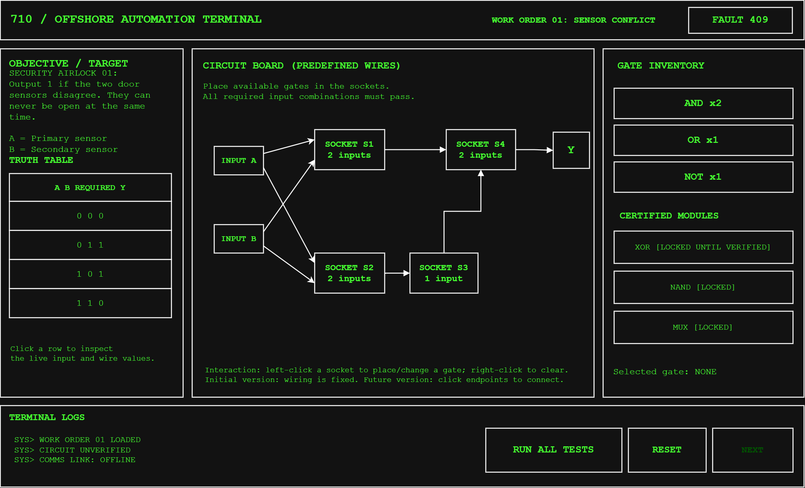
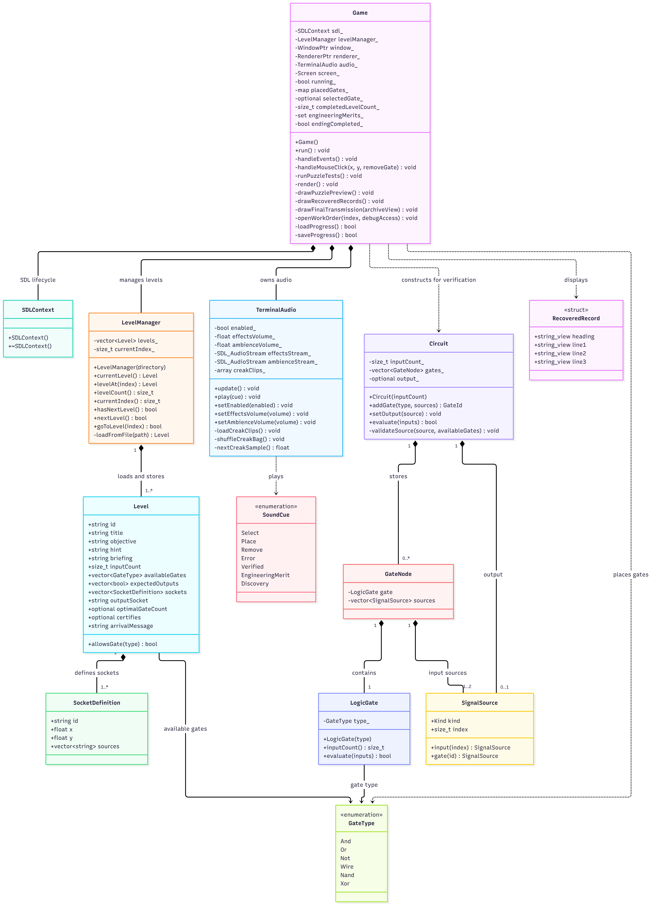
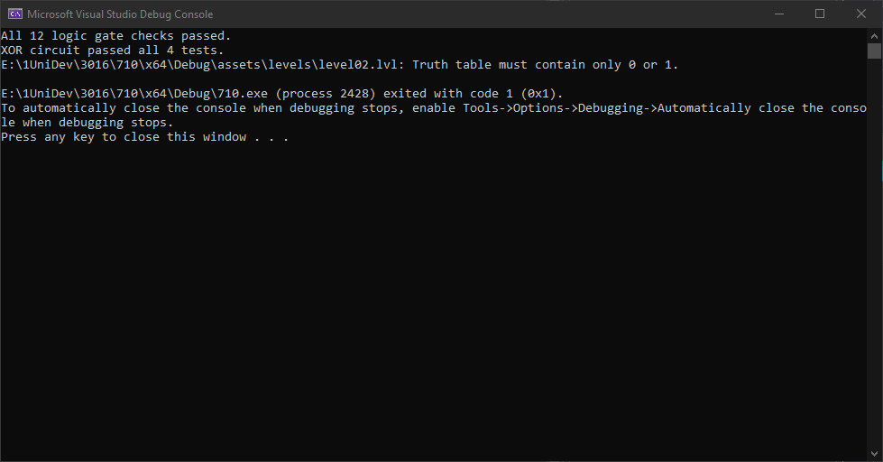
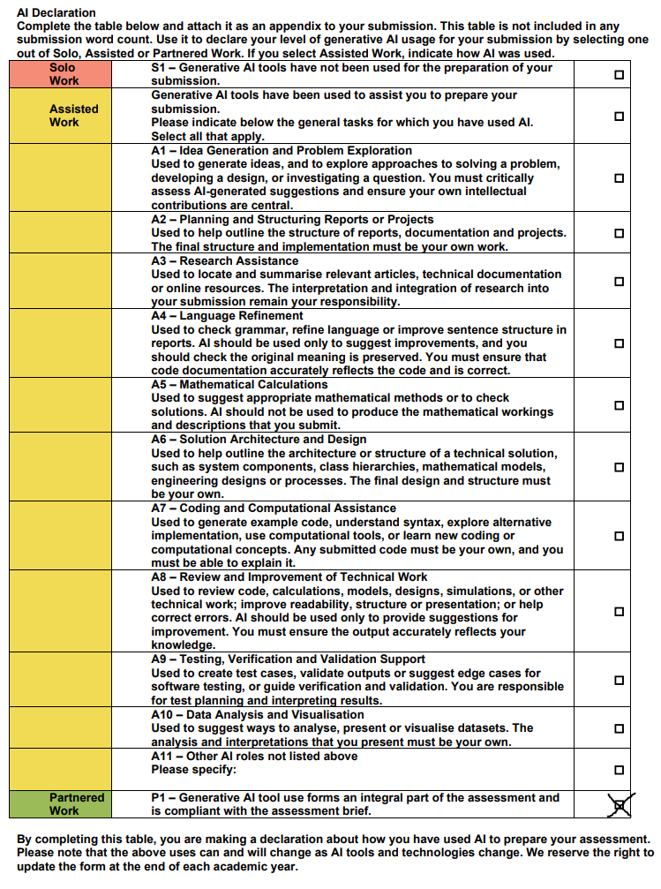

# 710 - COMP3016 Coursework 1 Report

**Student:** Roman Grixti  
**Student ID:** 10931611  
**Module:** COMP3016 — Immersive Game Technologies  
**Language:** C++20  
**Framework:** SDL3  

 

## 1. Introduction
710 is a 2D Boolean logic puzzle game set aboard an isolated offshore oil rig in the North Sea. The player assumes the role of an apprentice engineer who must restore a damaged automation terminal, following an unexplained and mysterious shutdown.

710 combines circuit construction with a level-by-level unfolding story. The player completes increasingly complex engineering work orders, requiring them to construct circuits that satisfy a truth table. Each work order completed also recovers a maintenance record, revealing part of the story, and why the rig has been abandoned. 

The original proposal for 710 described an apprentice engineer, alone on a weather-beaten offshore oil rig, who must restore a damaged automation terminal, and this premise was retained in the final game. There have been adaptations made to the story, of course. The recovered records reveal that drilling exceeded the authorised depth and that an unknown process subsequently interfered with the rig's systems. The crew disconnected communications with the mainland in an attempt to contain whatever threat it posed.

The title 710 refers to the appearance of the word OIL when the number 710 is rotated through 180 degrees in a seven-segment display. This concept appeared in the original proposal and is incorporated into the game's finale.

 

## 2. Original Proposal and Design Intent
The original proposal had three main design goals. The first was to create a puzzle game using only C++ and SDL3. The second was to use Object Oriented Programming (OOP) to separate gameplay, rendering, level management and circuit validation. The third was to create an atmospheric setting in which solving logic puzzles would reveal a larger narrative over time.

The proposal also mentioned fixed sockets and wiring, inspecting truth tables, diagnosing incorrect outputs, and reusing components verified from previous levels. These ideas were retained, with the addition of a few tutorial levels to introduce the player to the mechanics.

The intended scope was 7–10 progressively challenging puzzles, culminating in multi-input logic and reusable modules. Unfortunately, there were elements of the original proposal which were not implemented, like player-drawn connections between sockets, and seascape ambiance.

 

### 2.1 Mechanics, Dynamics and Aesthetics

---

**Mechanics:**

Players construct circuits by selecting logic gates and placing them in sockets. Each level provides a truth table and a set of components. The completed circuit is evaluated against all possible input combinations. The proposal also described manually toggling input states and constructing reusable compound modules. These features were not fully implemented in the final version.

 

**Dynamics:**
Players experiment with different gate combinations, test their solutions, interpret error messages and progressively develop an understanding of Boolean logic. Later work orders require more advanced logical reasoning, such as combining multiple conditions and implementing more complex truth-table behaviours.

 

**Aesthetics:**
The game aims to create isolation and suspense through its terminal-style presentation, recovered system logs, and industrial audio. The original proposal specified storm ambience like wind, rain and waves. During implementation, the sound design was more focused on low mechanical hums, structural groans and metallic contraction sounds. This was intended to make the platform itself feel ageing throughout gameplay. I also thought that since you're deep inside the structure, you wouldn't hear the storm outside, but you would feel it through the structure. The final game also includes a few sound effects for user interactions, like clicking components and completing/failing to complete circuits.

 

### 2.2 Original Visual Design

---

The proposal included a UML class diagram and a wireframe showing a three-panel puzzle interface.

The planned interface contained an objective and truth-table panel, a central circuit board and a gate inventory, with terminal logs and testing controls along the bottom.

This layout was retained in the final application, although some interface details changed during implementation.

Original:

 

Final:

 

## 3. Gameplay and Mechanics

### 3.1 Core Gameplay Loop
 ---

The finished game follows the loop established in the proposal:

1. Read the engineering work order and examine its target truth table.
2. Select logic gates from the available inventory.
3. Place or replace gates in predefined circuit sockets.
4. Run the circuit verification process.
5. Inspect failures and refine the solution.
6. Receive 710 VERIFIED when all input combinations pass.
7. Unlock the next work order and an associated recovered record.

The game is untimed, allowing players to experiment without time pressure.

 

### 3.2 Logic Gates and Circuit Construction
---

The game supports the following components:
- AND
- OR
- NOT
- NAND
- XOR
- WIRE (for bypassing single-input sockets)

Each work order contains a predefined set of connected sockets. The player chooses which permitted gates to place in those sockets, as long as the gate is compatible with the socket's number of inputs. For example, a two-input AND gate cannot be placed into a socket designed for a single-input NOT gate.

Players can remove or replace components as they wish, and they are not punished for incorrect solutions. They are, however, rewarded for efficient solutions using the fewest gates. 

Connections are loaded from the `level01.lvl` to `level10.lvl` files in assets/levels.

 

### 3.3 Work Orders and Difficulty Progression
--- 

The game contains ten work orders, meeting the original proposed range of 7–10 puzzles. The initial work orders introduce individual logic-gate behaviours and straightforward Boolean conditions. Later work orders require combinations of gates and much more complex thought processes.

Final Stages:
- **Work Order 08:** A selector or multiplexer-style logic problem.
- **Work Order 09:** A four-input majority condition.
- **Work Order 10:** Single-fault isolation, where the output must activate when exactly one of three fault channels is active.

The later puzzles are designed to encourage the player to apply knowledge gained from earlier work orders.

 

### 3.4 Truth Table Verification
---

Circuit verification is performed programmatically rather than relying on visual inspection. The evaluator processes every possible input combination for the work order and calculates the output of the player's circuit. Each result is compared against the corresponding expected output in the level's truth table. A work order passes only when every truth-table row matches. The game also detects incomplete circuits, and displays an appropriate error message. Feedback is provided immediately.

 

### 3.5 Engineering Merit
---

An additional Engineering Merit system rewards efficient circuit construction. Some work orders specify an optimal gate-count target. When a player completes such a work order using no more than the target number of logic gates, they earn an Engineering Merit. Wires are not counted as gates, and the player may use as many as they wish. More wires typically means a better solution.

Merit is optional and does not prevent progression. It encourages players to revisit completed work orders and improve their solutions.

 

## 4. Technical Implementation

### 4.1 Technologies
---

The project was developed using:

- C++20 for gameplay logic and application structure.
- SDL3 for window management, rendering, keyboard and mouse input, and audio.
- Visual Studio 2022 as the primary development environment.
- The C++ standard library for containers, memory management, file handling and other functionalities.

The approach was maintained from the original proposal.

 

### 4.2 Object-Oriented Architecture
---

The final architecture is simpler than the proposed UML design.

The main responsibilities are divided across the following classes:

| Component         | Responsibility |
|-------------------|----------------|
| `Game`            | Main game loop, rendering, screen transitions, input handling, saves and progression. |
| `LevelManager`    | Loading, storing and navigating work orders. |
| `Circuit`         | Building and evaluating connected Boolean circuits. |
| `LogicGate`       | Representing and evaluating individual logic-gate types. |
| `TerminalAudio`   | Terminal sound effects and ambient audio playback.|

Level definitions and recovered narrative records are maintained separately from the main rendering code. Although the proposal's UML included separate Renderer, InputHandler and ModuleLibrary components, the implementation does not reproduce that design exactly. Rendering and input handling are coordinated by Game, while the circuit system provides the core logic functionality.

Original:

Updated:

The updated UML class diagram illustrates the final implementation of 710. Compared with the original proposal, the architecture was simplified by consolidating rendering, input handling and gameplay progression within the `Game` class. `LevelManager` is responsible for loading and validating external work-order definitions, while `Circuit` and `LogicGate` handle Boolean evaluation independently of SDL3. The `TerminalAudio` class manages sound effects and environmental audio. This design retains object-oriented separation of the principal gameplay and logic responsibilities, although some of the originally proposed classes and reusable-module functionality were not implemented.

 

### 4.3 Circuit Representation 
---

Circuit connections are represented through signal sources referring either to external Boolean inputs or the outputs of earlier gates. When the player runs verification, the game constructs a circuit from the placed gates and the connection definitions in the current level. The evaluator processes the circuit for each truth table row and returns the resulting Boolean output. This separation allows the Boolean-logic system to operate independently of the rendered interface.

 

### 4.4 File-Driven Level System
---

The original proposal required level data to be loaded from external text files using standard C++ file I/O. This was implemented using `.lvl` files stored in assets/levels. Level files specify the title, objective, instructions, input signals, permitted gates, socket positions, socket connections, target truth table and output. The parser also supports information used by the progression and Engineering Merit systems. This approach makes it possible and relatively easy to create or modify work orders without changing any source code.

 

### 4.5 Save System
---

The game provides three independent save slots, with each slot storing completed work-order progress, earned Engineering Merits and whether the final containment sequence has been completed. Save data is stored in a user-specific application directory rather than alongside the executable (`%APPDATA%\710_Project\710`). This allows players to close the game and resume their progress later. Levels are reset if left incomplete.

 

### 4.6 Rendering and Interface
---

710 uses SDL3's 2D rendering functions to draw everything on the screen. A fixed logical resolution is used so that the interface can be scaled when the window is resized while preserving its aspect ratio.

The interface includes:
- An objective and target truth-table panel.
- A central circuit board with predefined connections.
- A gate inventory.
- Verification and reset controls.
- A system log.
- Work-order and save-file selection screens.
- A recovered-record archive.

Optional CRT scanlines and a blinking terminal cursor help to sell the appearance of an ageing electronic terminal.

 

### 4.7 Audio 
---

The audio system combines generated interface sounds with recorded ambient effects. Different sound cues provide feedback for gate selection, placement, removal, successful/not successful verification, and Engineering Merit. The ambient audio has a continuous low mechanical background and edited recordings of metal creaking and contraction. Ambient recordings are selected through a shuffled sequence that avoids playing the same recording consecutively. The delay between ambient recordings is randomised, with a range of 17–42 seconds after each clip finishes. Players can mute the audio and adjust ambience and effect volumes independently.

### 4.8 Programming Patterns and Error Handling

The game uses a state-driven approach to manage its screens. `Game` maintains a `Screen` enumeration for the save selection, main menu, puzzle interface, recovered records and ending. Input and rendering behaviour depend on the active screen. This provides a straightforward way to manage transitions without introducing a separate class for every state.

The application also follows a conventional game loop, which processes SDL events, updates audio and renders the current screen. RAII is used for SDL initialisation and resource ownership, including smart pointers with custom deleters for the window and renderer.

Error handling is particularly important for external level files. `LevelManager` validates the supplied data and throws exceptions when it encounters malformed definitions or invalid connections. `main.cpp` catches propagated exceptions and reports their messages. Within gameplay, incomplete circuits, incompatible gates and invalid save data are handled without allowing the affected operation to proceed.

[`>THIRD PARTY AUDIO CREDITS<`](CREDITS.txt)

 

## 5. Narrative and Player Experience

The original proposal established the mystery of an apparently accidental shutdown and used recovered terminal logs as the means of revealing further information, which has been retained and expanded in the final game. Each completed work order unlocks a recovered maintenance record. Records appear progressively, with individual lines revealed at intervals and a blinking underscore cursor indicating terminal activity.

The recovered records gradually establish that:
1. The rig drilled beyond its authorised depth.
2. An unknown process began interfering with equipment and issuing commands.
3. The process spread through the borehole telemetry and control systems.
4. The crew attempted to stop the machinery and contain the intrusion.
5. Communications with the mainland were deliberately disconnected to prevent the unknown process from spreading.
6. The player was left behind during the evacuation.

After completing Work Order 10, the player discovers that a backup mainland communication route remains active. The final interaction requires the player to issue a DISCONNECT command, isolating the platform. The conclusion purposely leaves the origin and nature of the suspicious process unknown.

 

### 5.1 Title Reveal
---

The original proposal described using the seven-segment number 710 to reference the word OIL. The final sequence animates this concept, with the display initially showing 710, followed by flashes and segment flickering. It then transitions to the rotated representation of OIL, which flashes three times before remaining illuminated. Unlike the preceding animation, the final screen does not advance automatically. The player must press a button to continue. The final transmission is also preserved as an additional recovered record, allowing the sequence to be revisited.

I have lots of ideas and wish I could expand on it further, but time has run out.

 

## 6. Comparison with Original Proposal

|Proposed Feature        |Final Implementation                |Outcome |
|------------------------|------------------------------------|--------|
|C++ and SDL3 application|Implemented using those technologies|Achieved|
|Boolean circuit construction|Select and place gates in fixed sockets|Achieved|
|7-10 puzzles |10 puzzles|Achieved|
|Truth table verification|Checks every input combination|Achieved|
|File-loaded levels and connections|External `.lvl` files|Achieved|
|Green terminal-style interface|CRT style terminal|Achieved|
|7 segment 710/OIL reveal|Animated 710 to OIL transition|Achieved|
|Recovered narrative logs|10 records + final transmission|Achieved|
|Manual input-state toggling|Automatic verification|Not achieved|
|Reusable compound modules| Implemented as unlocked compound gates|Partially achieved|
|Separate rendering/input/module-library classes| Responsibilities consolidated into the implemented class structure| Modified|
|Wind, rain and wave ambience| Mechanical hum, metal creaks and terminal effects|Modified|
|Player-editable wiring|Fixed connections loaded from level files|Stretch goal not achieved|
|Drag-and-drop modules|Click-to-select and click-to-place components|Stretch goal not achieved|
|Memory/latch puzzles|Combinational logic only|Stretch goal not achieved|

 

### 6.1 Justification of Scope Changes
---

The most significant departure from the original proposal was the removal of reusable compound modules. The proposal intended players to construct and reuse modules such as XOR from simpler gates. Although the final game includes XOR and NAND gate types and puzzles involving compound Boolean logic, players cannot save their own circuits as reusable components.

Implementing reusable modules would have required additional functionality for defining module inputs and outputs, storing circuit structures, validating nested connections and integrating saved modules into later levels. Instead, development concentrated on the correctness of the circuit evaluator, completing the planned number of work orders, implementing progression and providing a complete narrative experience.

The file-driven system retains fixed socket connections, which also limits the complexity of the interface and makes puzzle behaviour easier to verify. The revised scope still, however, supports the project's central learning objective of understanding and constructing Boolean circuits.

 

## 7. Development Process and AI Use
### 7.1 Development Roadmap
---

The original proposal divided development into three broad periods:
- **21–25 October:** Evaluator, SDL3 UI and early puzzles.
- **25–30 October:** File-loaded levels, truth-table testing and reusable modules.
- **31 October–5 November:** Complete 7 - 10 levels, playtest, refine, document and record video.

While some features were replaces or modified, development was generally ahead of schedule. The final game was completed on the 4th of November, with the remaining time used for playtesting, refinement and documentation.

 

### 7.2 AI-Assisted Development
---

The proposal explicitly identified ChatGPT as a tool for planning, debugging and asset generation, with its use to be recorded.

During development, ChatGPT was used for:
- Discussing gameplay mechanics and scope.
- Explaining C++ concepts and implementation choices.
- Suggesting code changes and debugging strategies.
- Reviewing circuit and level-system behaviour.
- Creating a python script to check valid/efficient solutions to puzzles.
- Designing and refining audio effects.
- Developing the recovered-record narrative.
- Creating testing checklists and documentation drafts.

Generated suggestions were never accepted without thorough personal review.

For example, early synthesised metal-creaking effects did not produce the intended industrial atmosphere. These were replaced with edited recordings, which underwent further revisions to their pitch, timing, transitions and layering. Also, a significant amount of C++ debug suggestions required extensive modification before integrating with the codebase, as they were often incomplete or incompatible with the existing architecture.

The full [AI Development Log](#ai-development-log) is included at the end of this report.

 

## 8. Testing and Evaluation
### 8.1 Functional Testing
---

| # | Area | Test | Expected Result | Result |
|-|-|-|-|-|
|1 |Circuit placement       | Place a gate in an incompatible socket | Placement rejected with an error | Success |
|2 |Incomplete circuit      | Run verification with an empty socket  | Verification fails safely        | Success |
|3 |Logic evaluation        | Submit a circuit with incorrect outputs| Work order reports failure       | Success |
|4 |Successful verification | Match every truth-table row            | Work order passes                | Success |
|5 |Progression             | Complete a newly authorised work order | Next work order unlocks          | Success |
|6 |Engineering Merit       | Meet a work order's gate-count target  | Merit awarded once               | Success |
|7 |Save system             | Close and reopen a save                | Progress remains intact          | Success |
|8 |Save isolation          | Change between save slots              | Progress does not transfer       | Success |
|9 |Recovered records       | Navigate through unlocked records      | Only available records are accessible | Success |
|10 |Audio controls          | Change volumes and mute                | Controls behave as expected      | Success |
|11 |Final sequence          | Complete Work Order 10 and DISCONNECT  | Ending plays and is recorded     | Success |
|12 |Animation               | Reopen the final recovered record      | Seven-segment reveal plays again | Success |

Testing was also performed by a friend on MacOS, and no new problems arose.

Test 1:

Test 2:

Test 3:

Test 4 and 5:

Test 6:

Test 7 and 8:

Test 9:

Test 10:

Test 11:

Test 11.1:

Test 12:

 

### 8.2 External Playtesting
---

 

Distributed Table (most recent, and adapted for markdown format):

## 710 — External Playtesting

**Tester:**  
**Date:**  
**Operating system:**  
**Game version/commit:**

### Table 1 — Functional Testing

Mark each result as Pass, Fail or N/A.

| # | Test / Action | Expected Result | Result | Comments |
|---|---|---|---|---|
| 1 | Create a new save slot | Game starts with Work Order 01 | | |
| 2 | Open the work-order briefing | Instructions and inputs are displayed clearly | | |
| 3 | Select, place, replace and remove gates | All actions work correctly | | |
| 4 | Place an incompatible gate in a socket | Error message appears | | |
| 5 | Run verification with empty sockets | Verification fails with an error | | |
| 6 | Run an incorrect circuit | Failed verification is shown | | |
| 7 | Complete a correct circuit | Work order passes and progression unlocks | | |
| 8 | Exit and reopen the save | Completed work orders remain unlocked | | |
| 9 | Open and navigate recovered records | Records display and navigation works | | |
| 10 | Toggle sound, volumes and CRT effects | Each setting responds correctly | | |
| 11 | View final transmission using a completed save | Animation and text display correctly | | |

### Table 2 — Usability Feedback

Rate each statement from 1 (strongly disagree) to 5 (strongly agree).

| # | Statement | Rating (1–5) | Comments |
|---|---|---|---|
| 1 | The game's objective was easy to understand. | | |
| 2 | Selecting and placing gates was intuitive. | | |
| 3 | The truth tables and verification feedback were clear. | | |
| 4 | The text and interface were easy to read. | | |
| 5 | The sound and visual presentation contributed to the atmosphere. | | |
| 6 | The puzzles increased in difficulty at a reasonable pace. | | |

### Table 3 — Problems and Suggestions

| # | Problem or suggestion | Where did it occur? | Severity (Low/Medium/High) |
|---|---|---|---|
| 1 | | | |
| 2 | | | |
| 3 | | | |

### Additional Feedback

**What was the most confusing part of the game?**

**What would you change or improve?**

**Any additional feedback?**

---

 

### Data From Testing (adapted for markdown format)
---
## TEST 1 - 710 — External Playtesting

**Tester:** `Tester 1` 
**Build date:** `22nd of October 2026` 
**Operating system:** `Windows 10` 
**Game version/commit:** `b9cf749` 
**Testing focus:** `Initial interactive circuit and verification system` 

### Table 1 — Functional Testing

| # | Test / Action | Expected Result | Result | Comments |
|---|---|---|---|---|
| 1 | Select AND, OR and NOT from the inventory | Selected gate changes | Pass | All three buttons responded correctly |
| 2 | Place AND into the circuit socket | AND appears in the socket | Pass | Worked as expected |
| 3 | Replace AND with OR | Socket displays OR | Pass | Replacing a gate was simple |
| 4 | Attempt to place NOT in the socket | Error 422 is displayed | Pass | Error appeared, but wasn't initially clear why |
| 5 | Run tests with an empty socket | Error 404 is displayed | Pass | Empty socket was identified |
| 6 | Run tests with OR selected and placed | Verification fails against the AND truth table | Pass | Reported three failed tests |
| 7 | Run tests with AND placed | All four tests pass | Pass | 710 VERIFIED appeared |
| 8 | Press RESET after placing a gate | Circuit and selection are cleared | Pass | Reset worked correctly |
| 9 | Resize the game window | Interface retains its proportions | Pass | Layout remained consistent |

### Table 2 — Usability Feedback

| # | Statement | Rating (1–5) | Comments |
|---|---|---|---|
| 1 | The game's objective was easy to understand. | 3 | Took a moment to understand what the truth table meant |
| 2 | Selecting and placing gates was intuitive. | 4 | Very straightforward after trying it once |
| 3 | The truth tables and verification feedback were clear. | 3 | I could see how many tests failed, but not which ones |
| 4 | The text and interface were easy to read. | 4 | Everything was visible, although the text was small |

### Table 3 — Problems and Suggestions

| # | Problem or suggestion | Where did it occur? | Severity (Low/Medium/High) |
|---|---|---|---|
| 1 | The error for placing NOT could explain that the socket needs two inputs | Circuit board | Low |
| 2 | It would help to see which truth-table rows failed | Verification | Medium |
| 3 | More circuits and levels are needed to make the game interesting | General gameplay | High |

### Additional Feedback

**What was the most confusing part of the game?**

I didn't initially understand why the NOT gate wouldn't fit in the socket. After looking at the inputs I realised that NOT only takes one input, whereas the socket has two.

**What would you change or improve?**

I'd like to see circuits with many gates I think it is an interesting challenge.

**Any additional feedback?**

The controls were straightforward and I liked the terminal-style interface. The verification system seemed to work correctly, but there wasn't enough content yet to judge the game as a whole. It definitely needs some visual polish too.

 

## TEST 2 - 710 — External Playtesting 

**Tester:** `Tester 2` 
**Build date:** `28th of October 2026` 
**Operating system:** `Windows 11` 
**Game version/commit:** `6af7651` 
**Testing focus:** `Multi-gate circuits, advanced inputs and difficulty progression` 

### Table 1 — Functional Testing

| # | Test / Action | Expected Result | Result | Comments |
|---|---|---|---|---|
| 1 | Select and place different logic gates | Gates appear in compatible sockets | Pass | Straightforward to use |
| 2 | Right-click a placed gate | Gate is removed from its socket | Pass | Worked and was explained in the inventory |
| 3 | Place an incompatible gate | Error 422 appears | Pass | Correctly rejected |
| 4 | Run tests with an empty socket | Error 404 identifies the socket | Pass | Useful error message |
| 5 | Submit an incorrect circuit | Verification reports failed combinations | Pass | Worked as expected |
| 6 | Complete a correct circuit | 710 VERIFIED appears | Pass | Successful verification displayed |
| 7 | Complete a work order | NEXT WORK ORDER becomes available | Pass | Progression worked |
| 8 | Use WIRE in a single-input socket | Signal passes through unchanged | Pass | Worked correctly |
| 9 | Complete a qualifying circuit efficiently | Engineering Merit is awarded | Pass | Merit appeared on the level |
| 10 | Progress through the gate-certification puzzles | NAND and XOR become available in later inventories | Pass | Additional gates appeared |
| 11 | View Work Order 06 with four inputs | Four input signals and a larger truth table are displayed | Pass | More difficult to follow |
| 12 | Use PageUp/PageDown on Work Order 07 | Five-input truth table can be paginated | Pass | Page controls worked |
| 13 | View Work Order 07 connections | Multiple gates and connections appear | Pass | Some connections were difficult to distinguish |

### Table 2 — Usability Feedback

| # | Statement | Rating (1–5) | Comments |
|---|---|---|---|
| 1 | The game's objective was easy to understand. | 4 | Early levels were clear, later ones needed more explanation |
| 2 | Selecting and placing gates was intuitive. | 5 | Right-click removal was useful |
| 3 | The truth tables and verification feedback were clear. | 4 | Larger truth tables took more effort to read |
| 4 | The text and interface were easy to read. | 3 | The connections sometimes crossed or came close together |
| 5 | The puzzles increased in difficulty at a reasonable pace. | 3 | The jump to four and five inputs felt quite large |

### Table 3 — Problems and Suggestions

| # | Problem or suggestion | Where did it occur? | Severity (Low/Medium/High) |
|---|---|---|---|
| 1 | Connections were difficult to follow in some larger circuits | Circuit board | Medium |
| 2 | Work Orders 06 and 07 needed clearer explanations | Objective panel | Medium |
| 3 | Paging through long truth tables was slightly tedious | Truth table | Low |

### Additional Feedback

**What was the most confusing part of the game?**

The five-input puzzle was difficult because there were so many possible combinations. I also had trouble following the wires between the sockets, particularly when several connections were close together.

**What would you change or improve?**

I'd make the wires easier to follow and add more detailed explanations for the later work orders. It might be helpful to explain what each external input represents rather than just showing A, B, C and so on.

**Any additional feedback?**

I liked the additional gates and the Engineering Merit system. Working out how to build NAND and XOR behaviour was interesting. The game felt much more complete than a basic logic simulator, although the more complicated circuits could be clearer.

 

## TEST 3 - 710 — External Playtesting 

**Tester:** `Tester 3` 
**Build date:** `4th of November 2026` 
**Operating system:** `Windows 11` 
**Game version/commit:** `c81531a` 
**Testing focus:** `Complete game, saves, audio, recovered records and ending` 

### Table 1 — Functional Testing

| # | Test / Action | Expected Result | Result | Comments |
|---|---|---|---|---|
| 1 | Create a new save slot | Game starts with access to Work Order 01 | Pass | New save worked |
| 2 | Open a work order and press I | Detailed briefing appears | Pass | Input descriptions were helpful |
| 3 | Select, replace and remove gates | Gate placement responds correctly | Pass | No problems |
| 4 | Place an incompatible gate | Error 422 appears | Pass | Correct error displayed |
| 5 | Run tests with an empty socket | Error 404 identifies the empty socket | Pass | Worked correctly |
| 6 | Submit an incorrect circuit | Verification fails | Pass | Failure shown clearly |
| 7 | Complete a work order | Progression and recovered record unlock | Pass | Both became available |
| 8 | Meet an Engineering Merit target | Merit is awarded | Pass | Reward appeared on the directory |
| 9 | Exit and reopen the game | Save progress is retained | Pass | Loaded correctly |
| 10 | Switch save slots | Independent progress is maintained | Pass | No crossover between saves |
| 11 | Open and navigate recovered records | Records display correctly | Pass | Previous and next buttons worked |
| 12 | Press M and F2–F5 | Audio controls respond | Pass | Mute and volume changes worked |
| 13 | Press F8 | CRT effects toggle | Pass | Visible difference |
| 14 | Complete Work Order 10 | Containment screen appears | Pass | Final screen displayed |
| 15 | Press D on the containment screen | Final reveal starts | Pass | 710-to-OIL animation played |
| 16 | Try to dismiss the ending immediately | Ending remains until sequence completes | Pass | Couldn't skip the animation |
| 17 | Reopen the final recovered record | Final transmission can be revisited | Pass | Animation replayed |

### Table 2 — Usability Feedback

| # | Statement | Rating (1–5) | Comments |
|---|---|---|---|
| 1 | The game's objective was easy to understand. | 4 | The detailed briefing was helpful |
| 2 | Selecting and placing gates was intuitive. | 5 | Very easy to learn |
| 3 | The truth tables and verification feedback were clear. | 5 | Errors and successful tests were easy to recognise |
| 4 | The text and interface were easy to read. | 4 | Some of the terminal text was still a bit small |
| 5 | The sound and visual presentation contributed to the atmosphere. | 5 | Mechanical ambience and CRT effects suited the setting |
| 6 | The puzzles increased in difficulty at a reasonable pace. | 4 | The final levels were difficult but satisfying |

### Table 3 — Problems and Suggestions

| # | Problem or suggestion | Where did it occur? | Severity (Low/Medium/High) |
|---|---|---|---|
| 1 | An optional hint system would help less experienced players | Advanced work orders | Low |
| 2 | The recovered records option could stand out more | Main menu | Low |
| 3 | Some text could be larger | General interface | Low |

### Additional Feedback

**What was the most confusing part of the game?**

The last couple of puzzles were quite difficult, especially the single-fault isolation one. The objective was understandable, but working out how to combine the available gates took a while.

**What would you change or improve?**

Maybe introduce an optional hint system for the difficult levels. I also think the recovered records could be easier to notice, because they're an important part of the story.

**Any additional feedback?**

I liked the atmosphere and how the story gradually developed through the recovered records. The audio made the platform feel like an old structure under stress. The ending was unexpected and the 710 turning into OIL was a good way to finish the game. I didn't encounter any serious functional problems.

## TEST 4 - 710 — External Playtesting

**Tester:** `Tester 4` 
**Build date:** `4th of November 2026` 
**Operating system:** `MacOS` 
**Game version/commit:** `c81531a` 
**Testing focus:** `MacOS compatibility, controls, save persistence and general usability` 

### Table 1 — Functional Testing

| # | Test / Action | Expected Result | Result | Comments |
|---|---|---|---|---|
| 1 | Launch the application | Game launches successfully | Pass | Opened without crashing |
| 2 | Create a new save slot | New game begins with Work Order 01 available | Pass | Worked as expected |
| 3 | Open a work order and view its briefing | Detailed instructions appear | Pass | Text displayed correctly |
| 4 | Select and place logic gates | Gates appear in compatible sockets | Pass | Trackpad clicking worked normally |
| 5 | Remove a placed gate using secondary click | Gate is removed | Pass | Two-finger clicking worked |
| 6 | Place an incompatible gate | Appropriate error is displayed | Pass | Error appeared |
| 7 | Run tests on an incorrect circuit | Verification fails | Pass | Failure message was clear |
| 8 | Complete a correct circuit | Work order is verified | Pass | Successfully completed |
| 9 | Exit and restart the application | Save progress is retained | Pass | Previous progress was restored |
| 10 | Navigate through recovered records | Unlocked records display correctly | Pass | No problems with navigation |
| 11 | Resize the application window | Interface maintains its aspect ratio | Pass | Interface scaled correctly |
| 12 | Toggle CRT effects using F8 | CRT effect changes | Pass | Had to use Fn + F8 |
| 13 | Adjust audio using F2–F5 and mute using M | Audio controls respond | Pass | Function keys required Fn |
| 14 | View the final transmission using a completed save | Ending animation plays correctly | Pass | No obvious rendering problems |

### Table 2 — Usability Feedback

| # | Statement | Rating (1–5) | Comments |
|---|---|---|---|
| 1 | The game's objective was easy to understand. | 4 | The briefing helped explain what was required |
| 2 | Selecting and placing gates was intuitive. | 4 | Worked well with the trackpad |
| 3 | The truth tables and verification feedback were clear. | 5 | Errors and successful results were easy to identify |
| 4 | The text and interface were easy to read. | 4 | Looked fine when resized, although some text was small |
| 5 | The sound and visual presentation contributed to the atmosphere. | 4 | Background creaking was effective without being distracting |
| 6 | The puzzles increased in difficulty at a reasonable pace. | 4 | Later puzzles were more challenging but understandable |

### Table 3 — Problems and Suggestions

| # | Problem or suggestion | Where did it occur? | Severity (Low/Medium/High) |
|---|---|---|---|
| 1 | Function-key controls required holding Fn on my keyboard | Audio and CRT controls | Low |
| 2 | The interface could benefit from larger text on smaller laptop screens | General interface | Low |
| 3 | Consider adding on-screen audio controls for easier access | Main menu | Low |

### Additional Feedback

**What was the most confusing part of the game?**

At first I didn't realise that I needed to hold the Fn key to use the audio and CRT controls, because those keys normally control things like screen brightness and volume on my Mac. The actual circuit controls were straightforward.

**What would you change or improve?**

It would be helpful to have clickable audio settings instead of relying entirely on function keys. I also think some of the text could be slightly larger when playing on a laptop.

**Any additional feedback?**

The game worked well with the trackpad and I didn't notice any significant problems with the interface. I liked the recovered records and thought the atmosphere was effective, particularly the background sounds. The puzzles became quite difficult towards the end, but I enjoyed working through them. I didn't encounter any crashes during this test.

---

 

## Testing Conclusions

### Collated Results

The four questionnaires cover three development stages across Windows 10, Windows 11 and macOS. The results recorded in the questionnaires are summarised below.

| Test | Build | Functional Tests Passed | Average Usability Rating |
|---|---|---|---|
| Tester 1 | 22 October | 9/9 | 3.50/5 |
| Tester 2 | 28 October | 13/13 | 3.80/5 |
| Tester 3 | 4 November | 17/17 | 4.50/5 |
| Tester 4 | 4 November (macOS) | 14/14 | 4.17/5 |
| **Total** | | **53/53** | **4.05/5 overall** |

The usability averages are calculated from the questions applicable to each version, so the earlier and later scores are not directly comparable.

### Findings and Improvements

The earlier questionnaires identified several areas requiring improvement. Initially, the game lacked sufficient content and some aspects of Boolean logic were difficult to understand without prior knowledge. This was early on, so that makes a lot of sense.

As more complex puzzles were introduced, feedback shifted towards the readability of circuit connections and the difficulty of interpreting larger truth tables. Subsequent development included improvements to wire routing, more detailed work order briefings and descriptions of external inputs.

The final two questionnaires recorded more positive feedback about the game's atmosphere, interface and narrative. The addition of recovered records, industrial audio and the final animation contributed to the overall experience.

Several suggestions remained, particularly larger text and optional hints for difficult puzzles. The macOS questionnaire also highlighted the inconvenience of using function-key shortcuts, suggesting that clickable settings could improve usability across platforms. Perhaps the standard numbers would've been better.

### Overall Conclusion

Across the supplied results, all 53 functional checks were marked as passed, with no major bugs reported. The feedback also suggests that later versions offered a more complete and accessible experience than the early prototype.

The remaining suggestions primarily concern usability rather than core functionality. Given the coursework deadline, these would be appropriate areas for future development.

Overall, the questionnaires illustrate a relatively playable game with no major issues, and some small text.

 

### 8.3 Problems Identified and Resolved
---

Several problems arose during implementation.

**Initial circuit evaluation and validation:** One of the first challenges was ensuring that the Boolean logic system could evaluate circuits independently of the graphical interface. I implemented tests for AND, OR and NOT gates, covering 12 individual checks. I also tested a compound XOR circuit constructed from AND, OR and NOT gates against all four possible input combinations. These tests passed, providing confidence in the evaluator before it was integrated into the SDL3 interface.

12 Gate Function:

XOR Test Function:

**Git evidence:**
- [Initial Boolean gate implementation and tests](https://github.com/MrabDflong/710/commit/cafd518)
- [Multi-gate circuit evaluation and XOR tests](https://github.com/MrabDflong/710/commit/cf2f14f)

**Level files not updating after building:** During early development, changes made to `.lvl` files were not always reflected when running the game through Visual Studio. This initially made it appear as though the parser was ignoring modifications. The issue was that an ordinary build did not copy updated assets into the executable's output directory. Rebuilding the solution refreshed the files. This became particularly important when testing whether invalid level definitions were detected correctly.

**Level-file validation:** The file-driven level system needed to handle malformed data without allowing invalid circuits to reach the game. For example, I deliberately inserted an invalid character (X) into a truth table to test the parser. Once the updated file was correctly copied, the application rejected it and reported an error. I also tested a nonexistent socket reference (s99) in level04.lvl, which was rejected successfully. Further validation was implemented for duplicate identifiers, missing properties, invalid or forward connections, and sockets with no compatible gates available. The parser also checks that the truth table contains exactly 2^n outputs for n inputs.

Debug Panel 1:

Debug Panel 2:

**Git evidence:**
- [File-loaded levels and work order progression](https://github.com/MrabDflong/710/commit/1c49763)
- [File-driven multi-gate circuit editor](https://github.com/MrabDflong/710/commit/72a965d)

**Multiple socket definitions:** The level-file format supports several `socket=` entries within the same work order. This required special handling because most other level properties should only appear once. The parser was designed to permit repeated socket declarations while rejecting duplicate definitions of ordinary properties. Socket references also needed to be validated in declaration order to prevent forward references or connections to nonexistent gates.

**Supporting increasingly complex puzzles:** The earlier puzzles used relatively simple circuits with two external inputs. As more levels were added, the interface needed to support more inputs, sockets, etc. External input positions were calculated for larger puzzles, while truth tables were divided into pages of five rows to prevent them extending beyond the available interface space, allowing more complex puzzles to use the same interface layout.

**Circuit connection rendering:** During refinement, I identified an unnecessary outer loop in the connection rendering code. This caused the full set of circuit connections to be drawn repeatedly for every socket. Removing the redundant loop reduced unnecessary rendering operations without changing the circuit layout or evaluation behaviour.

**Audio realism:** Early attempts to generate structural creaking sounds procedurally using AI did not achieve the intended atmosphere. Almost all of them sounded like a UFO, flatulence, or both. I replaced these with real edited recordings from the internet of metal creaking and contraction. The recordings were then split into shorter clips and adjusted for pitch, volume and timing. A shuffled playback system and randomised intervals were implemented to make the ambience less repetitive. [`>THIRD PARTY AUDIO CREDITS<`](CREDITS.txt)

**Recovered-record layout:** When the final transmission was incorporated into the recovered-record archive, its headings initially overlapped those drawn by the normal archive screen. The rendering structure was adjusted to stop the two layouts from drawing over one another, allowing the final transmission to use the existing archive navigation controls.

**Ending animation:** The seven-segment ending required several iterations to achieve the intended sequence of flickering, flashing and revealing OIL. One change introduced a reference to an undefined display-position variable, preventing the game from compiling. This was fixed by using consistent coordinates for the upright and rotated displays. The timing logic was also refined to prevent players from dismissing the ending before the animation finished.

**Recovered-record cursor:** Adding a blinking underscore cursor initially caused a debug assertion when calculating its position with an array index. The change was to calculate the cursor position as each line was rendered, removing the array lookup. This allowed the cursor to follow the most recently displayed line.

**Further Git evidence:**
- [Support for up to eight inputs and dynamic truth tables](https://github.com/MrabDflong/710/commit/6af7651)
- [Improvements to circuit alignment and wire routing](https://github.com/MrabDflong/710/commit/f5c2268)
- [Detailed work-order briefings and input descriptions](https://github.com/MrabDflong/710/commit/ed9471b)
- [Recovered records, audio and ending animation](https://github.com/MrabDflong/710/commit/c81531a)

 

### 8.4 Evaluation
---

The completed game achieves its central objective, which is to be an interactive Boolean-logic puzzle experience, implemented in C++ and SDL3.

There is a complete sequence of 10 work orders, deterministic truth table verification, file driven puzzles, object oriented separation of responsibilities, independent saves, efficiency awards, terminal-style presentation, and narrative progression through work order completion.

The main limitations are the lack of the reusable compound-module system, and the absence of the manual input toggling. 

 

### 8.5 Possible Future Improvements
---

Future development could introduce player-editable wiring, reusable subcircuits, drag-and-drop components and memory-based logic puzzles.

Further improvements could include additional work orders, more detailed circuit visualisation and expanded sound and animation systems.

 

## 9. Supporting Evidence and Demonstration

The repository and demonstration provide supporting evidence for the implementation.

**GitHub repository:** [https://github.com/MrabDflong/710](https://github.com/MrabDflong/710)

**Demonstration video:** [https://youtu.be/SONVK6t9HS8](https://youtu.be/SONVK6t9HS8)

**Original idea proposal:** [Original Proposal](710Proposal-COMP3016-RomanGrixti-10931611.pdf)

**AI Declaration From Brief:** 

 
 

## 10. References and Asset Attribution

- University of Plymouth. COMP3016 Coursework 1 Specification, 2026–2027.

- Grixti, R. 710 — COMP3016 Idea Proposal, 2026.

- SDL. SDL3 Documentation. [https://wiki.libsdl.org/SDL3/FrontPage](https://wiki.libsdl.org/SDL3/FrontPage)

- cppreference. C++ Language and Standard Library Reference. [https://en.cppreference.com/](https://en.cppreference.com/)

- smidoid. Iron Hinge Creak. Freesound. CC BY 4.0.

- martian. Metal Contraction Rattle Click. Freesound. CC0.

The edited audio assets are distributed with the appropriate source attribution and licence information.

 

## Conclusion

710 developed from a proposal for a small Boolean-logic puzzle game into a complete ten-work-order prototype with progression, persistent saves, atmospheric presentation and a narrative conclusion.

Although the reusable-module functionality and several stretch goals were not implemented, the finished game retains the proposal's central mechanics, intended atmosphere and somewhat educational focus.

The project demonstrates practical use of C++20, SDL3, object-oriented design, external file loading and systematic circuit verification. It also illustrates the importance of scope management, iterative testing and critical assessment of AI-assisted development.

 
 
 
 

# AI Development Log
**AI Tool:** ChatGPT 5.6 Luna

 

## 1. AI Usage
---
ChatGPT was used throughout development for planning, C++ assistance, debugging, audio processing, narrative development and documentation. I treated AI output as suggestions to evaluate rather than solutions to simply accept. AI had no access to my working files, and could only give assistance with the context pasted to it, usually around 10-15 lines of code. Code was reviewed and tested in Visual Studio 2022, while creative outputs were assessed against my intended design.

 

## 2. Notable Uses and Refinements
| Area | AI Contribution | My Evaluation & Changes |
|-|-|-|
| Planning and architecture | Helped develop the original concept, gameplay loop and OOP structure. Clarification of what does/doesn't qualify for RAII and OOP was particularly helpful. | I reduced the scope by excluding reusable modules, togglable external inputs, and editable wiring, prioritising a complete and functioning game. |
| C++ and circuit logic | Explained language concepts and assisted with circuit representation and evaluation. | I tested the evaluator using 12 basic gate checks and a compound XOR circuit covering four input combinations. |
| Level loading | Assisted with parser validation and debugging outdated `.lvl` files in the build directory. | I tested invalid truth tables and nonexistent socket references, confirming that malformed data was rejected. |
| Audio design | Generated experimental creaking sounds and assisted with editing recorded alternatives. | I rejected the ridiculous effects that it made, and downloaded some real recordings from the internet. [`>THIRD PARTY AUDIO CREDITS<`](CREDITS.txt) |
| Narrative and presentation | Suggested in-level terminal records, and an initial explanation for the rig's shutdown. | I rejected the in-level terminal records due to the small info section, and developed the deep borehole story instead. I then refined the end animation. |
| Code commenting and refactoring | Showed how to make functions more efficient and helped comment the files. | I tested the newly proposed functions and changed the comments to improve readability.

Debug Panel 1:

Debug Panel 2:

 

## 3. Example Prompts and Corrections
---
**Audio refinement**
>"I feel the downloaded sounds don't overlap enough, the ticks are too fast, and they're too high. Please edit them and provide me with multiple examples."

**AI Response (paraphrased):**

> "Yes, the current recordings have several issues affecting their realism. The contraction ticks are too sharp and high-pitched, making them sound more like small mechanical clicks than a large structure under stress. 
>The sounds should also overlap more naturally. Rather than having the ticking occur separately from the main creaking sound, some ticks should occur during the strongest parts of the groan, as if different parts of the structure are shifting simultaneously. We could produce several variations with different pitches, timing and overlap, allowing you to compare them and decide which sounds most convincing. `<Audio_File_1>`, `<Audio_File_2>`, `<Audio_File_3>`, `<Audio_File_4>`, `<Audio_File_5>`, `<Audio_File_6>`,`<Audio_File_7>`, `<Audio_File_8>`"

This feedback resulted in slower, lower-pitched contraction sounds with greater overlap. The final implementation uses eight edited recordings and randomised playback intervals of 17–42 seconds.

 

**Narrative direction**
>"Are these recovered records so far actually indicative of anything that happened? I don't feel they are. It shouldn't be ridiculously obvious, but the player has to know a bit more than what's currently implied here."

**AI Response (paraphrased):**
>"Agreed, the recovered records currently suggest that something went wrong aboard the rig, but they don't establish a particularly clear sequence of events. The player can see that safety systems were overridden and communications were interrupted, but there isn't enough information to understand why these things happened or how they relate to each other.

>One possible explanation would be that the supervisor deliberately interfered with the safety systems to keep drilling operations running, eventually causing a serious incident. The records could gradually reveal increasingly suspicious decisions, culminating in the rig's shutdown and evacuation. However, the story should avoid explaining everything directly. Each recovered record should provide another piece of evidence about the corporate greed behind the incident, allowing the player to reconstruct the events themselves."

I rejected the initial explanation involving deliberate corporate sabotage, it's very boring. Instead, I directed the story towards an unknown presence taking control of the rig after drilling too deep.

 

**Code debugging**

>"I'm getting this error, and only since trying to add the flashing cursor to the records. "The expression `Param(1)<3` is not true at this call." is what it says. What exactly does this mean?"

**AI Response (paraphrased):**
>"This Visual Studio assertion indicates that an array is being accessed outside its valid bounds. The array in drawRecoveredRecordLines() contains three elements, meaning its valid indices are 0, 1 and 2. The debugger is highlighting the expression lines[lastVisibleLine], so that is the first place to investigate.

>Changing the interval between lines should not ordinarily cause this problem, since the loop is supposed to prevent the index from exceeding the array's size. One way to make the implementation more robust is to remove the additional array access entirely.

>Instead of storing the index of the most recently displayed line and looking it up again, calculate the cursor's horizontal and vertical positions immediately after rendering each line. The blinking cursor can then use those stored coordinates. This simplifies the function and removes the array access that triggered the assertion."

AI-assisted cursor rendering triggered a Visual Studio error. I corrected the implementation by tracking the cursor's position during rendering rather than accessing the array again.

Other errors included an undefined displayY variable (it was in the wrong scope), and suggestions referring to outdated sections of Game.cpp. These required checking the code and making further corrections.

 

**Undefined displayY variable**
>"Visual Studio is reporting that displayY is undefined in Game.cpp. I also can't find the "IDENTIFIER: OIL" text you mentioned earlier. Are you referring to an older version of my code? I told you to respond based on the context I provide in each prompt, not anything else. What's going on here?"

**AI Response (paraphrased):**
>"You're correct. My previous instructions referenced code that doesn't exist in your current Game.cpp. The variable displayY was used without being declared in the appropriate scope, which caused the compilation error. The problem is that displayY was declared inside a specific block of code, meaning it was only accessible within that scope. When the animation attempted to reference it elsewhere, the compiler could no longer recognise the variable. Since the display already uses a fixed position, using 360.0f would be the simplest solution and would avoid introducing an unnecessary variable."

This error was caused by AI suggesting changes that did not match the current version of my code, despite being provided with the relevant context. I corrected the issue by replacing displayY with the existing Y coordinate (360.0f). This highlighted the importance of checking AI-generated code carefully, as trying to fix something (like in this scenario) can introduce errors by making incorrect assumptions about irrelevant things.

 

## 4. Verification and Evidence
AI-assisted changes were assessed mostly through code inspection, but also compilation, functional testing, and evaluation of AI-edited audio.

Relevant repository evidence:
- **`Circuit.cpp`**: Circuit implementation and logic tests.
- **`LevelManager.cpp`**: Level parsing and validation.
- **`Game.cpp`**: Gameplay, rendering and debugging corrections.
- **`TerminalAudio.h` and `assets/audio/`**: Ambient audio development.
- **`RecoveredRecords.h`**: Narrative changes.

 

## 5. Reflection
AI accelerated development, and helped me explore approaches I might otherwise have overlooked. However, its suggestions often contained errors or failed to match my intended results.

The most important lesson was to criticise proposed changes and verify their behaviour independently. All final decisions about implementation, scope and presentation remained mine.

 

**AI Declaration From Brief:** 

